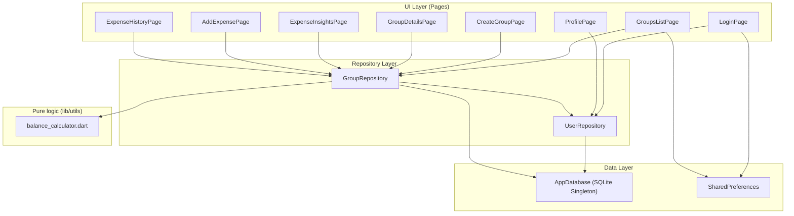
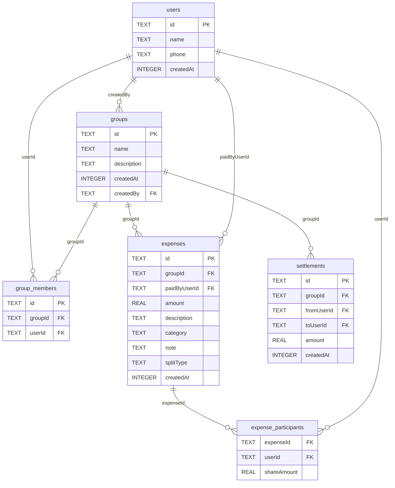
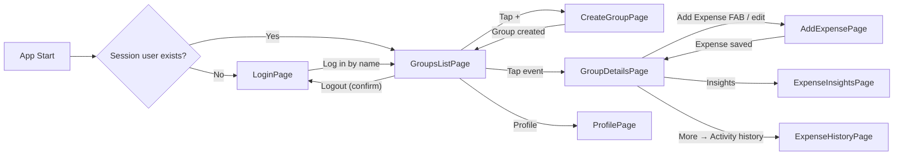

# Expense Splitter — Architecture

> Reference for any AI model or developer to understand, navigate, and extend this project. Updated for **v1.0.1** (database schema v5).

---

## 1. Project Overview

**Expense Splitter** is a Flutter app (Android, iOS, Windows, macOS, Linux; the web build only shows a "download the app" page) for splitting expenses among friends. Users create **groups** (called "Events"), add **expenses** with equal, unequal, or percentage splits, and the app computes **settlements** (who owes whom) using greedy debt simplification.

All data is stored **locally on the device** — there is no server and no sync between phones.

**Tech Stack:**
- **Flutter 3.38+** / Dart 3.10+, Material 3
- **SQLite** via `sqflite` (mobile) and `sqflite_common_ffi` (desktop)
- **SharedPreferences** for session (current user ID) and theme
- **UUID** for primary keys
- No state management library (uses `StatefulWidget` + `FutureBuilder`)
- No dependency injection framework (manual instantiation)

---

## 2. Current File Structure

```
lib/
├── main.dart                          # Entry point, platform init, one-time user merge, routing
├── database/
│   └── database.dart                  # SQLite singleton, schema v5, migrations, FK pragma
├── models/
│   ├── user.dart                      # User
│   ├── group.dart                     # Group, GroupBalanceView
│   ├── group_member.dart              # GroupMember (user + total paid in a group)
│   ├── expense.dart                   # Expense (with per-person shares), categories, stats models
│   ├── settlement.dart                # Settlement (paid or suggested)
│   └── friend_input.dart              # FriendInput (create-group form DTO)
├── repositories/
│   ├── user_repository.dart           # Identity: findOrCreateUser, login, duplicate merge
│   └── group_repository.dart          # Groups, expenses, settlements, stats (all SQL)
├── utils/
│   ├── balance_calculator.dart        # Pure money math: splits, balances, debt simplification
│   ├── currency.dart                  # ₹ formatting with Indian digit grouping
│   └── export.dart                    # Plain-text share summary
└── pages/
    ├── login_page.dart                # Log in by name (reuses an existing profile)
    ├── groups_list_page.dart          # Home: overall balance + event list
    ├── create_group_page.dart         # Create event with friends + up-front payments
    ├── group_details_page.dart        # Event: dashboard + Settle / Expenses / More tabs
    ├── expense_insights_page.dart     # Totals, categories, per-member net position
    ├── add_expense_page.dart          # Add / edit expense: equal, unequal, percentage
    ├── expense_history_page.dart      # Timeline with search + category filter
    └── profile_page.dart              # Edit name / phone
```

---

## 3. Architecture Diagram



---

## 4. Database Schema (v5)



- `PRAGMA foreign_keys = ON` is set for every connection (`AppDatabase.configure`), so the foreign keys above are enforced. Delete children before parents.
- `expense_participants.shareAmount` is what that person owes for the expense. `NULL` only on rows written before v5, which are read as an equal split.
- Indexes: `expenses(groupId)`, `settlements(groupId)`.

### Migration history

| Version | Change |
|---|---|
| v2 | `expenses` table |
| v3 | `expense_participants` table |
| v4 | `expenses.category`, `note`, `splitType` |
| v5 | `expense_participants.shareAmount`; "Initial payment" rows (saved with no participants) get every group member as participant; `expense_splits` dropped (it was never written); indexes |

On first launch of v1.0.1, `main.dart` also runs `UserRepository.mergeDuplicateUsers()` once (flag `duplicateUsersMerged` in SharedPreferences) to fold duplicate person rows created by older versions.

---

## 5. Navigation Flow



---

## 6. Core Business Logic

### 6.1 One source of truth for money
Every number on every screen comes from `lib/utils/balance_calculator.dart`, which works in whole paise internally:

- `computeBalances(memberIds, expenses, settlements)` — for each expense the **payer is credited the full amount** and **every participant is debited their share** (the payer too, if they took part). A settlement paid from A to B adds to A and subtracts from B. Balances always sum to zero.
- `simplifyDebts(balances)` — greedy matching of the biggest debtor with the biggest creditor; ties broken by user ID so suggestions are stable.
- `splitEqually`, `splitByPercentages`, `fitSharesToTotal` — turn an amount into per-person shares that add up to the amount **exactly** (leftover paise go to the first / largest share).

`GroupRepository` loads the data and calls these functions:
- `getGroupBalances(groupId)` → used by the Events screen (`getGroupsWithBalance`, overall = sum of those), the event dashboard ("your balance"), and the Insights page.
- `calculatePendingSettlements(groupId)` → `simplifyDebts(getGroupBalances(...))`.

Sign convention everywhere: **positive = others owe you (`+₹`, primary colour)**, **negative = you owe (`−₹`, error colour)**.

### 6.2 Expense split types
Every expense is **one row** in `expenses` plus one `expense_participants` row per person with their `shareAmount`.
- **Equal** — `addExpense(participantIds: …)` without `shares`; the repository splits it with `splitEqually`.
- **Unequal** — the page passes `shares: {userId: amount}`; empty fields get the remainder split among them; `0` means "had nothing".
- **Percentage** — the page converts with `splitByPercentages`; percentages must total 100.

`addExpense` / `updateExpense` reject shares that do not add up to the amount. Editing reopens an expense in its own split type with its stored shares filled in.

### 6.3 Identity (people)
People are identified **by name on this device** (`findOrCreateUser` in `user_repository.dart`): case-insensitive, whitespace-normalised. A phone number only separates two people with the same name. Logging in, creating an event, and adding a member all go through it, so the same name always reaches the same events. One event cannot contain the same person twice; the profile page refuses a name another profile already uses.

### 6.4 Settlements
"Mark as paid" stores a row in `settlements` (the amount can be lowered for a partial payment). Undo = `deleteSettlement(id)` (snackbar action, or the undo icon on a completed payment).

---

## 7. Key Models Reference

| Model | File | Purpose |
|-------|------|---------|
| `User` | `models/user.dart` | Person with name, optional phone |
| `Group` | `models/group.dart` | Event/group with name, creator |
| `GroupBalanceView` | `models/group.dart` | Group + current user's net balance |
| `GroupMember` | `models/group_member.dart` | User + total amount paid in group |
| `Expense` | `models/expense.dart` | Expense with payer, participants and `shares` |
| `Settlement` | `models/settlement.dart` | Payment from one user to another (paid or suggested) |
| `FriendInput` | `models/friend_input.dart` | DTO for create-group form |
| `MemberExpenseStats` | `models/expense.dart` | Per-member paid / share / settlement-aware net |
| `GroupExpenseStats` | `models/expense.dart` | Count, total, categories, member stats |
| `Transfer` | `utils/balance_calculator.dart` | One suggested payment from `simplifyDebts` |

---

## 8. Testing

```
test/
├── balance_calculator_test.dart   # pure money math + ₹ formatting
├── split_money_test.dart          # repository: balances, settlements, identity, FKs
├── migration_test.dart            # a real v4 (v1.0.0) database upgraded to v5
└── widget_test.dart               # login page smoke test
```

Repository tests run against a real SQLite database through `sqflite_common_ffi`.

---

## 9. Coding Conventions (For AI Models)

> [!IMPORTANT]
> Follow these conventions strictly to maintain consistency.

### File Organization
- **Models** go in `lib/models/` — plain Dart classes with `toMap()`, `fromMap()`, `copyWith()`
- **Repositories** go in `lib/repositories/` — classes that accept `AppDatabase` and do all SQL
- **Pages** go in `lib/pages/` — `StatefulWidget` classes with private `_State`
- **Utilities** go in `lib/utils/` — pure functions, no state

### Naming
- Files: `snake_case.dart`
- Classes: `PascalCase`
- Methods/variables: `camelCase`
- Private members: `_prefixed`

### Patterns Used
- **Singleton DB**: `AppDatabase()` always returns the same instance
- **Repository pattern**: Pages never access `AppDatabase` directly — always through a repository
- **Manual DI**: Each page creates its own `AppDatabase()` → `Repository(database: ...)` in `initState()`
- **Navigation**: `Navigator.push()` / `Navigator.pushReplacement()` with `MaterialPageRoute`
- **Data refresh**: Pages return `true` via `Navigator.pop(true)` to signal the parent to refresh
- **Loading states**: `bool _isLoading` + `CircularProgressIndicator` pattern
- **Error states**: `String? _errorMessage` displayed in red container
- **Transactions**: Use `db.transaction((txn) async { ... })` for multi-table operations

### Widget Style
- All pages use `Scaffold` with `AppBar`
- Cards: radius 20 from the theme; buttons/inputs radius 16 (see `lib/theme/app_theme.dart`)
- Colours only from `Theme.of(context).colorScheme` — no `Colors.*` outside the theme
- Color scheme: `Theme.of(context).colorScheme`
- Spacing: 8-point grid (8, 16, 24, 32)
- Money: never do arithmetic on amounts in pages — use `balance_calculator.dart`; format with `formatCurrency` / `formatSignedCurrency`
- After an `await`, check `if (!mounted) return;` before `setState`
- Form validation: `GlobalKey<FormState>` + `TextFormField.validator`

### Model Patterns
```dart
class MyModel {
  final String id;
  final String name;

  MyModel({required this.id, required this.name});

  Map<String, dynamic> toMap() => {'id': id, 'name': name};

  factory MyModel.fromMap(Map<String, dynamic> map) {
    return MyModel(
      id: map['id'] as String,
      name: map['name'] as String,
    );
  }

  MyModel copyWith({String? id, String? name}) {
    return MyModel(id: id ?? this.id, name: name ?? this.name);
  }
}
```

### Repository Pattern
```dart
class MyRepository {
  final AppDatabase _database;

  MyRepository({required AppDatabase database}) : _database = database;

  Future<void> doSomething() async {
    final db = await _database.database;
    await db.transaction((txn) async {
      // ... SQL operations
    });
  }
}
```

### Page Pattern
```dart
class MyPage extends StatefulWidget {
  const MyPage({super.key});

  @override
  State<MyPage> createState() => _MyPageState();
}

class _MyPageState extends State<MyPage> {
  late SomeRepository _repository;
  bool _isLoading = true;
  String? _errorMessage;

  @override
  void initState() {
    super.initState();
    _repository = SomeRepository(database: AppDatabase());
    _loadData();
  }

  Future<void> _loadData() async {
    setState(() { _isLoading = true; _errorMessage = null; });
    try {
      // ... load data
      setState(() { _isLoading = false; });
    } catch (e) {
      setState(() { _errorMessage = e.toString(); _isLoading = false; });
    }
  }

  @override
  Widget build(BuildContext context) {
    return Scaffold(
      appBar: AppBar(title: const Text('My Page')),
      body: _isLoading
          ? const Center(child: CircularProgressIndicator())
          : _errorMessage != null
              ? Center(child: Text(_errorMessage!))
              : _buildContent(),
    );
  }

  Widget _buildContent() {
    // ... build UI
    return const Placeholder();
  }
}
```

---

## 10. How to Run

```bash
# Install dependencies
flutter pub get

# Run on Linux desktop
flutter run -d linux

# Run on Android
flutter run -d <device-id>

# Analyze code
flutter analyze

# Run tests
flutter test
```

---

## 11. Dependencies (pubspec.yaml)

| Package | Version | Purpose |
|---------|---------|---------|
| `sqflite` | ^2.3.0 | SQLite for Android/iOS |
| `sqflite_common_ffi` | ^2.3.0 | SQLite for desktop (Windows/macOS/Linux) |
| `path` | ^1.8.3 | File path utilities |
| `shared_preferences` | ^2.2.2 | Key-value storage for user session |
| `uuid` | ^4.0.0 | UUID v4 generation for primary keys |
| `share_plus` | ^10.0.0 | Share the event summary |
| `cupertino_icons` | ^1.0.8 | iOS-style icons |

---

## 12. Known Limitations

1. **Local only** — no backup or sync; uninstalling the app deletes its data. Friends cannot see an event on their own phones.
2. **Names are identities** — two different friends with the same name need different names (e.g. "Rahul K", "Rahul S") or different phone numbers.
3. **Money is stored as `REAL`** — every amount is rounded to the paisa on write and computed in paise, but the column type is still floating point.
4. **Release signing** — release builds use the debug key. Create a real keystore before a Play Store upload.
