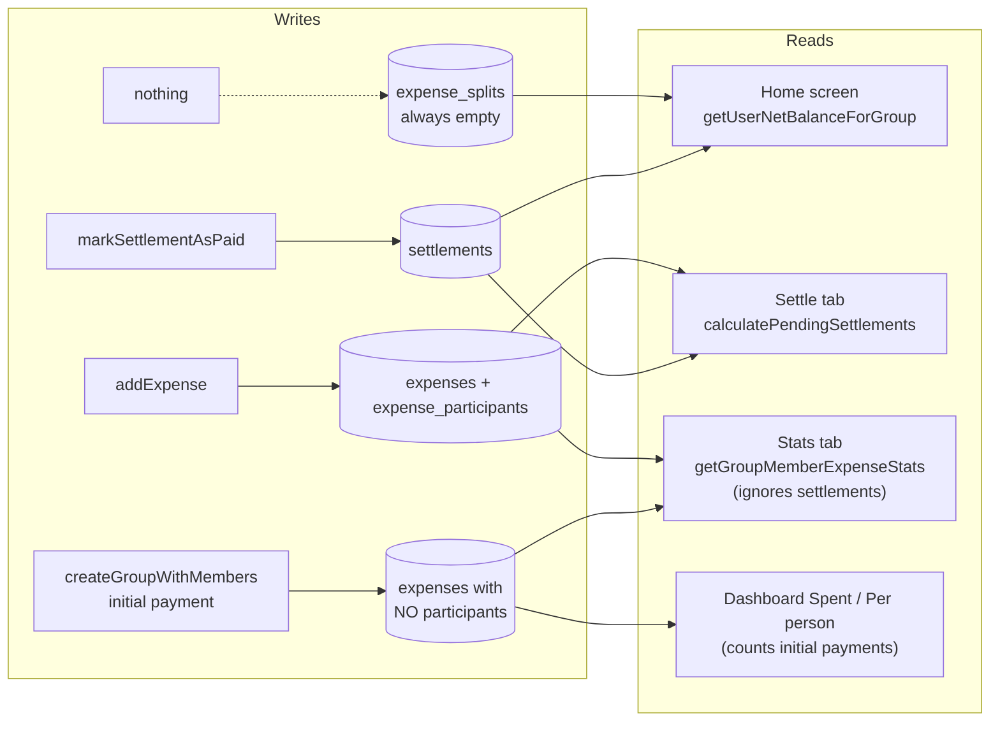

# Expense Splitter: Project Report (Planning Phase)

**Date:** 2026-10-29
**Repo:** `expense-splitter/` · branch `Soham` = `main` = `upstream/main` @ `6c267bf "app released"` (working tree clean)
**Remotes:** origin `Soham-Patel1604/expense-splitter` · upstream `Deval2211/expense-splitter`
**Status:** Analysis only. **No code or project files were changed.**

**What I read:** all of `lib/` (models, repositories, database, utils, theme, main, all 7 pages), `test/`, `pubspec.yaml`, `analysis_options.yaml`, `.vscode/`, `README.md`, `docs/ARCHITECTURE.md`, `docs/AUDIT-REPORT.md`, `docs/UI-REVIEW.md`, and `Expense splitter bugs.md`.
**What I skipped on purpose:** the prototype/APK (`Expense-Splitter-v1.0.0.apk`), `design/penpot/`, `docs/tasks/*` (old specs, already shipped), and the generated platform folders.

---

## 1. Summary

1. **The home screen balance is computed from a table nothing writes to.** `getUserNetBalanceForGroup()` reads `expense_splits`, and nothing in the app inserts into that table. Before any payment is marked, every event shows **"Settled"**. After one is marked, it shows the **wrong sign**. This is the root cause of bugs **#5** and most likely **#6**.
2. **Money initially paid at event creation never gets split.** "Amount paid" is saved as an expense with **zero participants**, so the settlement algorithm skips it, while the "Spent", "Per person" and "Paid" figures still count it. This is a second, independent cause of bug **#5**.
3. **Three screens use three different balance formulas** (Home, Settle tab, Stats tab). They can't agree, so the + and − signs look random to users.
4. **Login always creates a new user.** Logging out and back in with the same name gives you a fresh, empty identity, and your old events are orphaned (bug **#3**).
5. **There's a silent data-corruption path in Edit Expense.** The split-type selector stays active in edit mode. Switching to Unequal or Percentage saves the **full amount split equally**. The earlier audit didn't catch this.
6. Bugs **#1, #2, #4** are UI-level and each is small (FAB overlap, move insights to their own page, ₹ only).
7. There's no test on the settlement or balance math, and that's exactly where the bugs are.

**Recommendation:** fix the money logic first (one shared balance function plus tests), then identity/login, then the UI bugs, then repo hygiene. Section 8 has the phases and section 9 has the decisions needed before coding starts.

---

## 2. Project snapshot

| Item | Value |
|---|---|
| App | Flutter expense splitter: events, members, expenses (equal / unequal / %), greedy debt simplification, mark-as-paid, history, search, share, dark mode |
| Storage | Local-only SQLite (`sqflite`; `sqflite_common_ffi` on desktop). Session = `currentUserId` in SharedPreferences |
| Sync / backend | **None.** All data lives on one device. Uninstalling the app deletes everything |
| State mgmt | `StatefulWidget` + `FutureBuilder`, manual DI (`AppDatabase()` singleton) |
| Platforms | Android (shipped APK), Windows/macOS/Linux via FFI; Web shows a fallback page only |
| Toolchain | Local Flutter **3.38.9**; `pubspec` SDK `^3.10.4`; README claims "Flutter 3.47+ / Dart 3.13+" (out of date) |
| DB schema | v4, 7 tables (`users`, `groups`, `group_members`, `expenses`, `expense_participants`, `expense_splits`, `settlements`) |
| Tests | 3 repository tests (`test/split_money_test.dart`) + 1 login smoke test |

### Code size (`lib/`, ~7.6k lines)

| File | Lines | Role |
|---|---:|---|
| `pages/add_expense_page.dart` | 1434 | Add/edit expense, 3 split modes |
| `pages/group_details_page.dart` | 1423 | Event dashboard + 4 tabs (Settle / Expenses / Stats / More) |
| `repositories/group_repository.dart` | 915 | **All business logic + SQL** |
| `pages/expense_history_page.dart` | 677 | Timeline + search + category filter |
| `pages/groups_list_page.dart` | 555 | Home: overall balance + event cards |
| `pages/create_group_page.dart` | 494 | New event + friends + "amount paid" |
| `pages/profile_page.dart` | 393 | Name/phone edit + currency picker |
| `main.dart` | 273 | Init, theme notifier, web fallback |
| `theme/app_theme.dart` | 251 | Design tokens (M3, light/dark) |
| `pages/login_page.dart` | 208 | Profile creation |
| `database/database.dart` | 192 | Schema + migrations v1→v4 |
| models + utils | ~530 | `Expense`, `Group`, `Settlement`, `FriendInput`, currency, export |

### Architecture

```
Pages (StatefulWidget) ──► GroupRepository / UserRepository ──► AppDatabase (SQLite singleton)
          └──────────────► SharedPreferences (currentUserId, themeMode, currencySymbol)
```

The 3-layer split is clean and pages don't touch SQL directly. The weak spot is that **balance logic is duplicated inside the repository** in three places:



---

## 3. Reported bugs: root cause and proposed fix

Source: `Expense splitter bugs.md`. Its screenshots are Obsidian embeds (`![[Screenshot_2026…]]`) and the image files are **not in the folder**, so I matched each bug to the code by its description. Bugs #1 and #6 should be confirmed against the screenshots.

Effort: **S** = under 2 h · **M** = about half a day to 1 day · **L** = 2+ days

### Bug #1: "Button hides numbers" (S)

- **Most likely cause:** the extended FAB "Add Expense" (`group_details_page.dart:587-591`) floats bottom-right over the tab content. The tab scroll views only pad 16 px (`group_details_page.dart:691, 729, 751`). Amounts and edit/delete icons are right-aligned, so the last card's numbers sit under the button.
- The UI review already flagged this as finding **#8** and it was never fixed.
- **Fix:** bottom padding of at least 88 on the Settle, Expenses and Stats scroll views, or hide the FAB on non-Expenses tabs.

### Bug #2: "Expense insight should be on another page" (S–M)

- **Current:** insights are the Stats tab inside the event page (`group_details_page.dart:745-763`, card at `:1047-1189`).
- **Fix:** new `lib/pages/expense_insights_page.dart`. Move `_buildEventInfoCard` and `_buildStatsCard` there, and open it from the "per person" dashboard card and/or the More tab. Then drop the Stats tab (3 tabs) or repurpose it. **Decision needed:** see section 9.
- **Do this after the balance fix** (Phase 1). Otherwise we'd be moving numbers that are still wrong.

### Bug #3: "Logout then login with the same name must show all events of that name" (M)

- **Cause:** `login_page.dart:53-56` always calls `createUser()`, which generates a new UUID. Logout (`groups_list_page.dart:52-62`) only removes `currentUserId`. Events are linked by user **ID**, so the "new you" has no memberships.
- **Related:** the same person also gets duplicated as a *friend*. The `createGroupWithMembers` dedupe query is `name = ? AND phone = ?` (`group_repository.dart:81-85`), and in SQL `phone = NULL` is never true. So every phoneless friend becomes a **new user row in every event**. (`addNewMemberToGroup` handles NULL correctly at `:349-351`, so the two paths are inconsistent.)
- **Fix options** (pick one, see section 9):
  - **A.** On login, look up an existing user by normalized name (+ phone if given). One match: reuse it. Several: show a picker. None: create a new user.
  - **B.** Replace "Logout" with "Switch profile", which lists the local profiles.
  - **C.** Make phone the unique identity key.
- In all cases, fix the NULL-phone dedupe and normalize names (trim + case-insensitive). Existing duplicate rows need a merge step.
- ⚠️ If the expectation is that **your friend sees the same event on their own phone**, that's not a bug fix. It needs a backend (e.g. Supabase or Firebase). The app is local-only today.

### Bug #4: "Keep only the Indian currency symbol" (S)

- **Current:** 8 symbols in `utils/currency.dart:10-19`, a picker in `profile_page.dart:320` / `:135-138`, and the choice persisted in SharedPreferences.
- **Fix:** remove the picker and the `supportedCurrencySymbols`/`setCurrencySymbol` path, and hardcode `₹`. Optionally add Indian grouping (`₹1,23,456.00`) through `intl` `NumberFormat.currency(locale: 'en_IN', symbol: '₹')`, which is one new dependency. Ignore any stored `currencySymbol` pref.

### Bug #5: "I owe ₹250 to Soham but it shows all settled; show − and + properly" (M). Highest priority.

There are **two independent root causes**, and both produce exactly this symptom.

**Cause 1: Home screen reads an empty table.** `getUserNetBalanceForGroup()` (`group_repository.dart:215-258`) computes `credit − debit` from `expense_splits`. `addExpenseSplit()` (`:621`) has **zero callers**, so `credit` and `debit` are always 0. The `ARCHITECTURE.md` §6.3 warning noted this inconsistency but it was never fixed.

| Step | Settle tab (correct) | Home card + hero (wrong) |
|---|---|---|
| Soham pays ₹500, split equally with me | "You owe Soham ₹250" | **"Settled"** / "All settled up 🎉" |
| I mark ₹250 as paid | All settled | **"+₹250, You're owed"** (sign inverted) |

**Cause 2: Initial payment at event creation isn't split.** `createGroupWithMembers` stores "Amount paid" as an expense with **no `expense_participants`** (`group_repository.dart:111-120, 124-133`). `calculatePendingSettlements` loops over participants (`:507`), finds none, and adds nothing.

| Screen | Shows |
|---|---|
| Dashboard | Spent ₹500 · ₹250 per person |
| Event info / export | "Soham paid ₹500" |
| Settle tab | **"All Settled! 🎉"** |
| Stats › Member Net Position | Soham **+₹500**, me **₹0** (the totals don't even balance) |

**Fix:**
1. Write one pure function, `computeBalances(members, expenses, settlements) → Map<userId, double>`, and use it for Home, Settle, Stats and Export.
2. Stop reading `expense_splits` (drop it in migration v5).
3. Store initial payments with all members as participants, or remove that field from the create screen. **Decision needed.**
4. Show the sign consistently everywhere: `+₹` / green = you're owed, `−₹` / red = you owe.
5. Write unit tests for the function first.

### Bug #6: "New entry in an old event doesn't sync with another event" (M, needs confirmation)

Likely meanings, in order of probability:
1. **Adding an expense to an existing event doesn't update the Home screen** (event chip + overall hero). Same root cause as #5 Cause 1. The Home screen never looks at expenses.
2. **The same friend exists as separate user rows in each event** (the NULL-phone dedupe in #3), so their position doesn't carry across events or into the overall total.
3. **Expecting cross-device sync.** This isn't supported (see #3).

→ The Phase 1 fix resolves (1). The Phase 3 dedupe resolves (2). Please confirm with the screenshot.

### Bug #7: empty in the notes. Is anything pending?

---

## 4. Additional issues found (not in the bug list)

### P0: wrong money, silently

| # | Issue | Where |
|---|---|---|
| E1 | Home/overall balance from the empty `expense_splits` table (bugs #5, #6) | `group_repository.dart:215-296` |
| E2 | Initial payments never split (bug #5) | `group_repository.dart:111-133` |
| E3 | **Edit + switch split type = wrong split.** Edit forces `SplitType.equal` (`add_expense_page.dart:99`), but the selector is still shown and tappable (`:538`, `:762-768`). Choosing Unequal or Percentage then calls `updateExpense` with the **full amount** and the participant list, labeled `'unequal'`, and the settlement math splits it **equally**. | `add_expense_page.dart:357-384` |

### P1: incorrect or inconsistent behavior

| # | Issue | Where |
|---|---|---|
| E4 | **Unequal/percentage splits are saved as N separate expense rows** ("Dinner - Rahul", "Dinner - Amit"…), each in its own transaction. This is non-atomic (audit F3 is still open), the expense list and history show fragments, "Expenses logged" and "Average expense" are inflated, and the split can't be edited or deleted as one expense. | `add_expense_page.dart:398-433` |
| E5 | Stats "Member Net Position" = paid − owed and **ignores settlements**, so it disagrees with the Settle tab after any payment | `group_repository.dart:859-895` |
| E6 | Duplicate users: NULL-phone dedupe; no duplicate-friend check in the create form; the creator can add themselves as a friend | `group_repository.dart:81-85`, `create_group_page.dart` |
| E7 | Login always creates a new identity (bug #3) | `login_page.dart:53-56` |

### P2: robustness

| # | Issue | Where |
|---|---|---|
| E8 | Money stored as `REAL` (float) and never rounded. Percentage tolerance lets totals drift ±0.01 % (audit F5 still open). Best practice is integer paise. | schema, `add_expense_page.dart:284, 420` |
| E9 | SQLite foreign keys **are not enforced**: no `PRAGMA foreign_keys = ON` (`onConfigure`), so every `FOREIGN KEY` in the schema is decorative | `database.dart:27-35` |
| E10 | Unequal split: an invalid or 0 entry keeps the **previous** `consumption.amount` (it isn't reset), so a stale value can be saved | `add_expense_page.dart:203-209` |
| E11 | "Per person" = total ÷ all members. That's misleading when expenses have subsets or unequal shares. Duplicated at `group_details_page.dart:598-602` and `:919-923` | |
| E12 | "Mark as paid" can't be undone, and there are no partial payments | `group_repository.dart:607` |
| E13 | `setState` after `await` with no `mounted` check (audit F7 still open). `expense_history_page.dart` has **0** guards | pages |
| E14 | N+1 queries: `getGroupExpenses` runs 2 queries per expense; Home recomputes per event. Fine now, slow with many expenses | `group_repository.dart:774-831` |
| E15 | No backup/restore. Uninstall or phone change = all data lost | |

### P3: cleanup

- Dead code with zero callers: `addExpenseSplit`, `createGroup`, `addMemberToGroup`, `getAllUsers`, `deleteUser`, `GroupBalanceView.balanceText`.
- `'phone = ""'` uses a double-quoted string literal (`group_repository.dart:351`). This relies on deprecated SQLite behavior; use `''`.
- `User` model lives inside `user_repository.dart`; `GroupMember` lives in `settlement.dart`.
- Undisposed `TextEditingController`s in `create_group_page.dart` dialogs (`:64-66`, `:162`).

---

## 5. Repository and release hygiene

| Issue | Why it matters | Suggested action |
|---|---|---|
| **58 MB APK committed to git** (`Expense-Splitter-v1.0.0.apk`) | Bloats every clone permanently | Attach it to GitHub Releases, add `*.apk` to `.gitignore`. Optionally purge it from history (that's a force-push, so needs agreement) |
| `logo.png` **missing** | Referenced by `flutter_launcher_icons` in `pubspec.yaml` and the README ``, so icon regeneration fails and the README image is broken | Commit `logo.png` |
| `applicationId = "com.example.expense_splitter"`, release signed with the **debug key** | The Play Store rejects `com.example`. Changing the ID after release creates a *different* app | Pick the final ID **now** and create a release keystore (kept out of git) |
| `pubspec.yaml` description is "A new Flutter project." | Cosmetic | Update |
| Version claims out of date | README says Flutter 3.47+ while the local toolchain is 3.38.9 | Align the README with the real toolchain |
| `docs/ARCHITECTURE.md` stale | Says "no web support", lists the shipped tasks as "remaining", links to `file:///home/deval/...` | Refresh it after Phase 1–2 |
| **`.vscode/tasks.json` auto-runs `npx -y @penpot/mcp@beta` on folder open**, and `settings.json` auto-approves `npx`/`flutter` for AI chat terminals | Every time the folder opens it downloads and runs an **unpinned beta npm package**: a supply-chain risk for everyone who clones the repo | Pin the version, make it a manual task, drop the `npx` auto-approve |
| `web_entrypoint.dart` at the repo root | Unused and confusing | Remove or document |

---

## 6. Status of earlier audits (verified in the current code)

| Finding | Status |
|---|---|
| AUDIT F1: editing an unequal row redistributes money | **Mitigated** (edit opens as Equal), but a **new variant, E3**, is open |
| F2: no tests on money paths | **Partial**: 3 repo tests added; **zero** on settlements/balances |
| F3: multi-row split not atomic | **Open** (E4) |
| F4: currency change doesn't refresh Home | **Fixed** (unconditional refresh, `groups_list_page.dart:71-80`). Moot after bug #4 |
| F5: percentage drift | **Open** (E8) |
| F6: undisposed controllers | Fixed in `group_details_page`; **open** in `create_group_page` |
| F7: `setState` without `mounted` | **Open** (E13) |
| F10: dead code | **Open** (section 4, P3) |
| UI-REVIEW #1: transparent bottom sheet | **Fixed** (`app_theme.dart:137-142`) |
| UI-REVIEW #6: Home re-queries on every build | **Fixed** (future cached); the N+1 itself remains (E14) |
| UI-REVIEW #8: FAB covers the last card | **Open** (this is bug #1) |

Neither audit caught E1 (the empty `expense_splits` read), E2 or E3. Those are the most serious issues in the app.

---

## 7. Test coverage gap

| Area | Tested? |
|---|---|
| `addExpense` / `updateExpense` round-trip, `deleteExpense`, `deleteGroup` cascade | ✅ |
| `calculatePendingSettlements` (greedy algorithm) | ❌ |
| `getUserNetBalanceForGroup` / overall balance | ❌ (a test would have caught E1 immediately) |
| Initial payment handling | ❌ |
| Unequal / percentage validation and saving | ❌ |
| Login / identity reuse | ❌ |

**Proposed:** pure-Dart unit tests for the new `computeBalances()` (no DB needed), plus repository tests that use the existing `sqflite_common_ffi` setup in `split_money_test.dart`.

---

## 8. Proposed plan (for approval, nothing started)

### Phase 1: Money correctness (fixes #5, #6-likely, E1, E2, E3, E5) · ~1–2 days
1. Extract `computeBalances()` as a pure function and write its tests **first**.
2. Route Home, overall total, Settle tab, Stats and Export through it.
3. Initial-payment handling (per the decision in section 9).
4. Disable or hide the split-type selector in edit mode, or properly support re-splitting (see Phase 2).
5. One sign convention everywhere (`+` owed to you / `−` you owe).

### Phase 2: Data model v5 (E4, E8, E9) · ~1–2 days
1. Add `expense_participants.shareAmount` so **one expense row holds per-person shares**. Unequal and percentage become single, atomic, editable expenses.
2. Migration v5: keep the old single-participant rows (still valid), drop `expense_splits`, enable `PRAGMA foreign_keys`.
3. Round shares to 2 dp and give any remainder to the last participant (or move to integer paise; **decision**).

### Phase 3: Identity (fixes #3, E6, E7) · ~1 day
1. Login reuses an existing profile (option A/B/C in section 3, bug #3).
2. Fix the NULL-phone dedupe, normalize names, block duplicate friends and self-add.
3. One-time merge of duplicate user rows already on testers' devices (if we keep their data).

### Phase 4: UI bugs (fixes #1, #2, #4) · ~1 day
1. FAB padding (#1).
2. `ExpenseInsightsPage` (#2).
3. ₹ only, optional Indian digit grouping (#4).
4. Undo for "Mark as paid" (E12) and a clearer "per person" label (E11).

### Phase 5: Hygiene and release · ~half a day
APK out of git, `logo.png`, final `applicationId` + release keystore, VS Code task pin, README/ARCHITECTURE refresh, `mounted` guards, dead-code removal.

**Order rationale:** Phases 1→2 touch the same code (the balance and expense write paths), so they go first and together. #2 (insights page) only makes sense once its numbers are right. Phase 5 can run in parallel at any time.

---

## 9. Decisions needed before coding

1. **Initial "amount paid" at event creation:** split equally among all members, or remove the field and make people add a normal expense?
2. **Login identity (#3):** match by name, by name + phone, or show a "choose profile" list? **Is cross-device sync expected?** If yes, that's a backend project, not a bug fix.
3. **Insights (#2):** separate page reached from where (dashboard card / More tab)? Keep 4 tabs or go to 3?
4. **Existing tester data:** do we migrate and merge duplicates, or is it OK to reset the DB once?
5. **Money storage:** keep `REAL` with rounding (smaller change) or switch to integer paise (correct, bigger migration)?
6. **Bug #6:** can you share the two screenshots? They aren't in the folder.
7. **Bug #7** is empty. Is anything pending?
8. **APK in git history:** just stop tracking it, or also rewrite history (force-push)?
9. **Final Android `applicationId`** before any Play Store upload.

---

## 10. Verification notes

- All findings come from reading the source. **`flutter analyze` and `flutter test` were not run**, because the project has no `.dart_tool/` yet and running them would trigger `pub get` and write into the project. We can run them as the first step once changes are approved.
- Claims about "zero callers" or "never written" were checked with grep across `lib/` and `test/`.
- Line numbers refer to commit `6c267bf`.

---

## 11. Status after v1.0.1 (2026-10-29)

All findings above were worked on for v1.0.1. `flutter analyze`: no issues. `flutter test`: 30 tests pass, including a real upgrade of a v1.0.0 database.

**One more root cause of bug #5 turned up during the fix.** The old settlement algorithm credited the payer **only if the payer was also a participant**. Unequal and percentage splits were stored as one row per person, so the payer was never credited for anyone else's share. A friend's −₹250 had no matching +₹250, so no settlement was generated and the app showed "All settled". The new `computeBalances()` always credits the payer the full amount.

### Reported bugs

| Bug | Status | What changed |
|---|---|---|
| #1 Button hides numbers | ✅ Fixed | 96 px bottom padding on Home, Settle and Expenses; the FAB is hidden on the More tab |
| #2 Insights on another page | ✅ Fixed | New `ExpenseInsightsPage` (AppBar icon, More tab, "your balance" card). Event page has 3 tabs |
| #3 Same name after logout shows old events | ✅ Fixed | Login reuses the profile by name; friends are matched by name too; one-time merge of old duplicate rows; logout asks for confirmation |
| #4 Indian currency only | ✅ Fixed | Picker removed; `₹` with Indian grouping (`₹1,23,456.00`) everywhere |
| #5 Shows "All settled" while money is owed; +/− wrong | ✅ Fixed | One balance function for every screen; payer always credited; initial payments split; "You owe −₹" / "owes you +₹" wording |
| #6 New entry in an old event not reflected | ✅ Fixed (likely cause) | The Home screen now reads the same balances as the event page; the same friend is one person across events |

### Other findings

| # | Status |
|---|---|
| E1 home balance from empty table | ✅ `expense_splits` dropped; Home uses `computeBalances` |
| E2 initial payments not split | ✅ Split among all members (new events + v5 migration of old ones) |
| E3 edit + switch split type | ✅ Edit reopens in its own split type with stored shares; saves real shares |
| E4 unequal/% saved as N rows | ✅ One expense with per-person `shareAmount`, one transaction |
| E5 stats ignore settlements | ✅ Insights net = Settle tab balances |
| E6 / E7 duplicate users, login identity | ✅ `findOrCreateUser` + `mergeDuplicateUsers`; duplicates and self-add blocked |
| E8 float money | ✅ Computed in paise, shares always sum exactly. Column type still `REAL` |
| E9 foreign keys not enforced | ✅ `PRAGMA foreign_keys = ON` |
| E10 stale unequal amount | ✅ Reset on every validation; invalid input is reported |
| E11 misleading "per person" | ✅ Dashboard shows *your* balance; Insights shows "Average per member" |
| E12 no undo / partial payment | ✅ Partial amount in the confirm dialog; Undo snackbar + undo icon |
| E13 `setState` without `mounted` | ✅ Guards added on all pages |
| E14 N+1 queries | ✅ Expenses in 2 queries, members and counts in 1; indexes on `groupId` |
| E15 no backup/restore | ❌ Not done. It's a new feature; needs a decision on where backups go |
| P3 cleanup | ✅ Dead code removed, `User`/`GroupMember` in their own model files, quote fix, controllers disposed |

### Repository and release

| Item | Status |
|---|---|
| APK in git | ✅ `*.apk` git-ignored. v1.0.0's APK is still tracked; untracking it needs a commit (not done) |
| `logo.png` missing | ✅ Restored from commit `03df330` |
| `applicationId` | ✅ `com.expensesplitter.app`, so v1.0.1 installs alongside v1.0.0 |
| Release keystore | ❌ Not created. Still debug-signed; decide who owns the keystore before the Play Store |
| Version | ✅ `1.0.1+2` |
| README / ARCHITECTURE | ✅ Updated |
| VS Code auto-run `npx @penpot/mcp@beta` | ✅ No longer runs on folder open; `npx` auto-approve removed |
| `web_entrypoint.dart` | ✅ Removed (unused) |
| Cross-device sync | ❌ Out of scope (needs a backend) |
